# Диагностика Random Walk и AR(1): train и validation

## Цель, данные и ограничения

Объяснить отсутствие выигрыша AR(1) на разностях CLOSE относительно RW в validation за 2025 год.
Это исследование сохранённых прогнозов, а не настройка моделей. Новые модели не обучались.
Использованы исходный MOEX ISS CANDLE_CLOSE, календарь reconstructed_moex_calendar_provisional
и артефакты results/benchmark_calendar_v2. Календарная интеграция A2 завершена: 1 668 календарных
дат, 1 160 ожидаемых и наблюдаемых торговых дат, 0 пропусков/неожиданных свечей; рабочие субботы сохранены.
Все 254 validation-пары каждого горизонта и метрики совпали с A1; старые файлы не изменены.
Train: 683 цены (2022-04-26–2024-12-30), validation: 254 цены (2025-01-03–2025-12-30).
Цены final test отрезаны до любых диагностических преобразований; final test не оценивается.
Сохраняются conditional EOD / pseudo-PIT, предварительность календаря и неопределённость исторического
времени публикации свечей. Наблюдаемая candle date не доказывает доступность в конкретную минуту.

## Методика, зафиксированная до расчёта

- ACF/PACF: лаги 1–20; ACF с общим знаменателем n, PACF Yule–Walker MLE (`ywm`).
- Ljung–Box: лаги 5/10/20, model_df=0 для исходных рядов, без автоматического выбора лагов.
- Train и validation анализируются отдельно; разность/доходность первой validation-сессии может
  использовать последнюю train-цену. Ряды разделяются на непрерывные сегменты при пропусках;
  сегменты короче 42 наблюдений не тестируются и не склеиваются.
- HAC для среднего d: Bartlett/Newey–West, L=max(20,h−1), поправка n/(n−1), нормальный 95% интервал.
  Лаг покрывает перекрытие горизонтов и фиксирован заранее. Это асимптотические точечные интервалы,
  не одновременные; ограниченная мощность и оценивание коэффициентов моделей сохраняются как ограничения.
  При пропусках origin pooled HAC не рассчитывается. Holm p-values дополнительно показаны
  для семейства всех Ljung–Box тестов и отдельно для семи HAC-сравнений; результаты исследовательские.
- Волатильность: std последних 20 log-доходностей, ddof=1, включая только данные по origin.
  Границы — линейные train-терцили, затем неизменны; группы n<30 явно отмечены.
- Ошибки prediction−actual и d=e_AR²−e_RW² сравниваются на одинаковых origin/target/horizon.
  Все семь горизонтов участвуют в HAC; детальные графики — h=1,3,5,7. Изменений benchmark-правил нет.

Реализации и определения: [ACF](https://www.statsmodels.org/stable/generated/statsmodels.tsa.stattools.acf.html),
[PACF](https://www.statsmodels.org/stable/generated/statsmodels.tsa.stattools.pacf.html),
[Ljung–Box](https://www.statsmodels.org/stable/generated/statsmodels.stats.diagnostic.acorr_ljungbox.html),
[HAC](https://www.statsmodels.org/stable/generated/statsmodels.stats.sandwich_covariance.cov_hac.html).

## Сохранённые коэффициенты

Каждый origin учитывается один раз, без семикратного дублирования по h. Отдельно показаны все доступные
train/validation origins и origins, использованные хотя бы для одного validation-target (включая конец train).

| scope | coefficient | n | mean | median | std | min | max | positive_share | negative_share | nonzero_sign_changes |
| --- | --- | --- | --- | --- | --- | --- | --- | --- | --- | --- |
| all_available_train_validation_origins | phi | 836 | 0.0662852 | 0.0644191 | 0.0139382 | 0.0459712 | 0.11007 | 1 | 0 | 0 |
| all_available_train_validation_origins | c | 836 | 0.0166588 | 0.0245961 | 0.0358164 | -0.143873 | 0.0741586 | 0.879187 | 0.120813 | 1 |
| validation_forecast_origins | phi | 260 | 0.0534912 | 0.0536627 | 0.00365263 | 0.0459712 | 0.061616 | 1 | 0 | 0 |
| validation_forecast_origins | c | 260 | 0.0134644 | 0.00847928 | 0.0106103 | 0.00271415 | 0.04192 | 1 | 0 | 0 |

На validation-forecast origins phi: среднее 0.0534912, диапазон [0.0459712, 0.061616], смен ненулевого знака 0.
Константа c: среднее 0.0134644, диапазон [0.00271415, 0.04192].
Смена знака не доказывает смену рыночного режима; значимость отдельных OLS-коэффициентов не проверялась.

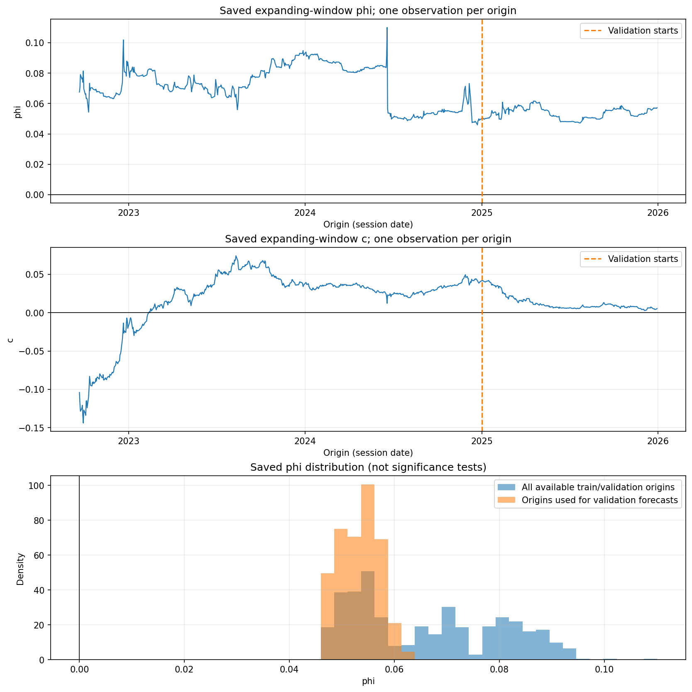

## Серийная зависимость и волатильность

| split | series | segment | n | first_date | last_date | lag | lb_stat | p_value | p_holm |
| --- | --- | --- | --- | --- | --- | --- | --- | --- | --- |
| train | change | 1 | 682 | 2022-04-27 00:00:00 | 2024-12-30 00:00:00 | 5 | 3.25465 | 0.660791 | 1 |
| train | change | 1 | 682 | 2022-04-27 00:00:00 | 2024-12-30 00:00:00 | 10 | 12.4962 | 0.253217 | 1 |
| train | change | 1 | 682 | 2022-04-27 00:00:00 | 2024-12-30 00:00:00 | 20 | 17.443 | 0.624046 | 1 |
| train | log_return | 1 | 682 | 2022-04-27 00:00:00 | 2024-12-30 00:00:00 | 5 | 2.90538 | 0.71457 | 1 |
| train | log_return | 1 | 682 | 2022-04-27 00:00:00 | 2024-12-30 00:00:00 | 10 | 15.0967 | 0.128575 | 1 |
| train | log_return | 1 | 682 | 2022-04-27 00:00:00 | 2024-12-30 00:00:00 | 20 | 20.5098 | 0.42647 | 1 |
| train | abs_log_return | 1 | 682 | 2022-04-27 00:00:00 | 2024-12-30 00:00:00 | 5 | 295.016 | 1.18033e-61 | 1.88853e-60 |
| train | abs_log_return | 1 | 682 | 2022-04-27 00:00:00 | 2024-12-30 00:00:00 | 10 | 399.998 | 9.42298e-80 | 1.60191e-78 |
| train | abs_log_return | 1 | 682 | 2022-04-27 00:00:00 | 2024-12-30 00:00:00 | 20 | 524.008 | 2.71186e-98 | 4.88136e-97 |
| validation | change | 1 | 254 | 2025-01-03 00:00:00 | 2025-12-30 00:00:00 | 5 | 2.97272 | 0.704191 | 1 |
| validation | change | 1 | 254 | 2025-01-03 00:00:00 | 2025-12-30 00:00:00 | 10 | 6.17861 | 0.800041 | 1 |
| validation | change | 1 | 254 | 2025-01-03 00:00:00 | 2025-12-30 00:00:00 | 20 | 14.7307 | 0.791601 | 1 |
| validation | log_return | 1 | 254 | 2025-01-03 00:00:00 | 2025-12-30 00:00:00 | 5 | 3.44207 | 0.632171 | 1 |
| validation | log_return | 1 | 254 | 2025-01-03 00:00:00 | 2025-12-30 00:00:00 | 10 | 6.40327 | 0.780321 | 1 |
| validation | log_return | 1 | 254 | 2025-01-03 00:00:00 | 2025-12-30 00:00:00 | 20 | 13.9955 | 0.830725 | 1 |
| validation | abs_log_return | 1 | 254 | 2025-01-03 00:00:00 | 2025-12-30 00:00:00 | 5 | 17.5079 | 0.00363084 | 0.0508318 |
| validation | abs_log_return | 1 | 254 | 2025-01-03 00:00:00 | 2025-12-30 00:00:00 | 10 | 24.5757 | 0.00621043 | 0.0807356 |
| validation | abs_log_return | 1 | 254 | 2025-01-03 00:00:00 | 2025-12-30 00:00:00 | 20 | 43.417 | 0.00180007 | 0.0270011 |

Ниже описаны все фактически рассчитанные тесты. Малые p-values трактуются как свидетельство против
отсутствия серийной корреляции в исследуемом сегменте, а не как доказанный OOS-выигрыш данной AR(1).
Автокорреляция signed returns относится к линейной зависимости изменений; автокорреляция абсолютных
доходностей относится к зависимости масштаба движений. Кластеризация волатильности сама по себе не
означает предсказуемость направления и улучшение условного среднего цены.

Минимальные необработанные p-values для changes/log returns: train=0.1286, validation=0.6322. На заданных лагах нулевая гипотеза отсутствия корреляции
не отвергается при 5%; это не доказательство полного отсутствия предсказуемости.
Для абсолютных log returns минимальные Holm-p: train=4.881e-97, validation=0.027. Это свидетельство кластеризации масштаба движений
в этих выборках, а не доказательство полезности данной AR для направления цены. Обычный Ljung–Box
не является универсальной проверкой условного среднего при произвольной гетероскедастичности.

### train

| series | n | acf | pacf |
| --- | --- | --- | --- |
| change | 682 | 0.049638 | 0.049638 |
| log_return | 682 | 0.0484749 | — |
| abs_log_return | 682 | 0.349825 | — |

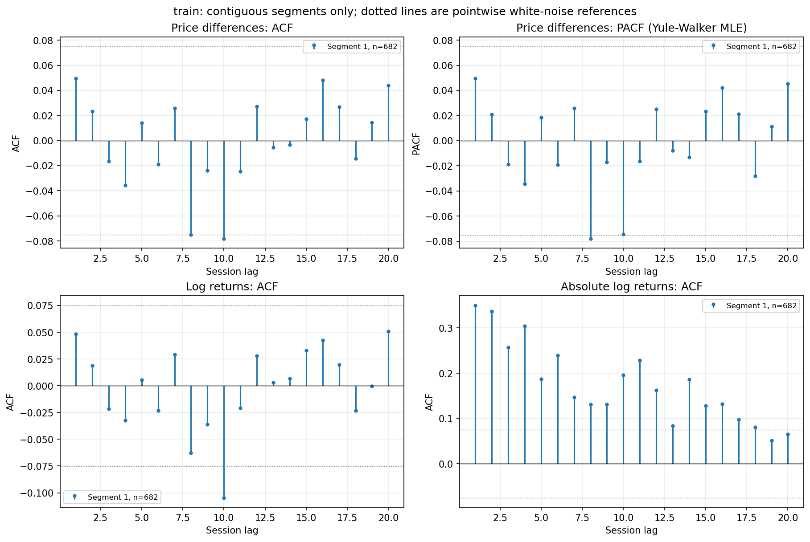

### validation

| series | n | acf | pacf |
| --- | --- | --- | --- |
| change | 254 | 0.0605984 | 0.0605984 |
| log_return | 254 | 0.0546413 | — |
| abs_log_return | 254 | 0.126688 | — |

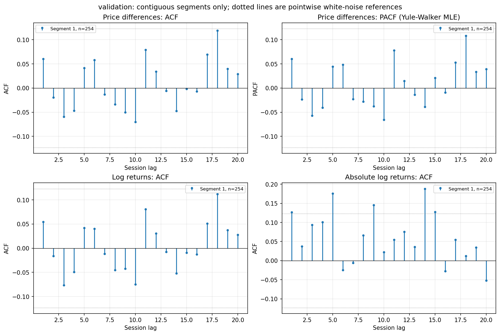

Обработка календаря/сегментов:

| split | series | segment | n | first_date | last_date | status |
| --- | --- | --- | --- | --- | --- | --- |
| train | change | 1 | 682 | 2022-04-27 00:00:00 | 2024-12-30 00:00:00 | used |
| train | log_return | 1 | 682 | 2022-04-27 00:00:00 | 2024-12-30 00:00:00 | used |
| train | abs_log_return | 1 | 682 | 2022-04-27 00:00:00 | 2024-12-30 00:00:00 | used |
| validation | change | 1 | 254 | 2025-01-03 00:00:00 | 2025-12-30 00:00:00 | used |
| validation | log_return | 1 | 254 | 2025-01-03 00:00:00 | 2025-12-30 00:00:00 | used |
| validation | abs_log_return | 1 | 254 | 2025-01-03 00:00:00 | 2025-12-30 00:00:00 | used |

## Ошибки, накопленные потери и устойчивость

Положительное d означает меньшую квадратичную ошибку RW. Положительная конечная сумма D не означает,
что AR хуже на каждой дате; доля d>0 и квартальные суммы показывают эпизодичность различий.

| horizon | n | mean_d | ci_lower | ci_upper | p_normal | p_holm | rw_better_share | bias_rw | bias_ar | error_correlation | top5_absolute_d_share |
| --- | --- | --- | --- | --- | --- | --- | --- | --- | --- | --- | --- |
| 1 | 254 | 0.00248197 | -0.00618792 | 0.0111519 | 0.574737 | 0.574737 | 0.523622 | 0.095 | 0.10243 | 0.998423 | 0.138434 |
| 2 | 254 | 0.0191198 | -0.00101485 | 0.0392545 | 0.0627193 | 0.152055 | 0.555118 | 0.188661 | 0.209519 | 0.99908 | 0.128462 |
| 3 | 254 | 0.0491715 | 0.0100103 | 0.0883326 | 0.0138563 | 0.0969941 | 0.570866 | 0.283346 | 0.318524 | 0.999264 | 0.129096 |
| 4 | 254 | 0.0885075 | 0.0137662 | 0.163249 | 0.020289 | 0.121734 | 0.598425 | 0.37437 | 0.423965 | 0.999315 | 0.172874 |
| 5 | 254 | 0.13206 | 0.0124526 | 0.251668 | 0.0304628 | 0.152055 | 0.622047 | 0.465748 | 0.529897 | 0.999286 | 0.183193 |
| 6 | 254 | 0.187222 | 0.017707 | 0.356737 | 0.030411 | 0.152055 | 0.661417 | 0.56 | 0.639066 | 0.999247 | 0.164713 |
| 7 | 254 | 0.26153 | 0.018651 | 0.504409 | 0.0348177 | 0.152055 | 0.669291 | 0.656457 | 0.750859 | 0.999229 | 0.173609 |

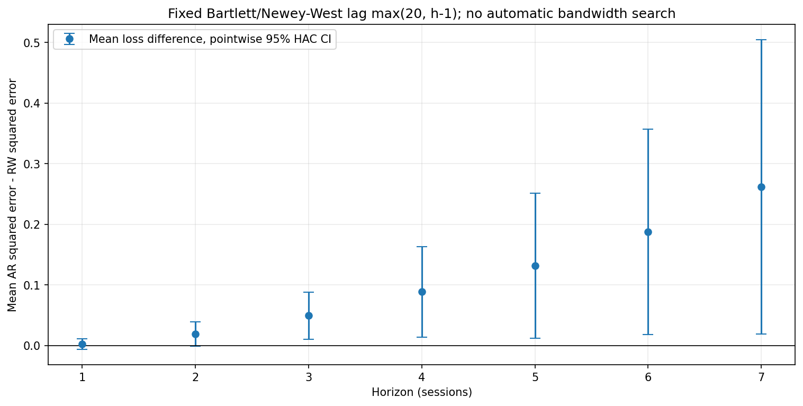

Доля top5 относится к сумме |d| пяти наиболее крупных по |d| пар относительно всех |d|, а не к доле RMSE.
Пары не удаляются. Конкретные даты, ошибки и вклады сохранены в influential_errors.csv.
Квартальные суммы (по target_date) позволяют увидеть, равномерно ли накапливалась разница:

| horizon | target_quarter | n | sum_d | mean_d |
| --- | --- | --- | --- | --- |
| 1 | 2025Q1 | 61 | 0.688418 | 0.0112855 |
| 1 | 2025Q2 | 62 | 0.682258 | 0.0110042 |
| 1 | 2025Q3 | 66 | -0.656342 | -0.00994458 |
| 1 | 2025Q4 | 65 | -0.0839122 | -0.00129096 |
| 2 | 2025Q1 | 61 | 4.051 | 0.0664099 |
| 2 | 2025Q2 | 62 | 1.3007 | 0.0209791 |
| 2 | 2025Q3 | 66 | -0.680556 | -0.0103115 |
| 2 | 2025Q4 | 65 | 0.185286 | 0.00285055 |
| 3 | 2025Q1 | 61 | 8.54909 | 0.140149 |
| 3 | 2025Q2 | 62 | 3.21568 | 0.0518659 |
| 3 | 2025Q3 | 66 | -0.516537 | -0.00782632 |
| 3 | 2025Q4 | 65 | 1.24132 | 0.0190972 |
| 4 | 2025Q1 | 61 | 16.4063 | 0.268955 |
| 4 | 2025Q2 | 62 | 4.41983 | 0.0712877 |
| 4 | 2025Q3 | 66 | -0.516538 | -0.00782634 |
| 4 | 2025Q4 | 65 | 2.17132 | 0.0334049 |
| 5 | 2025Q1 | 61 | 25.2107 | 0.413291 |
| 5 | 2025Q2 | 62 | 5.9919 | 0.0966435 |
| 5 | 2025Q3 | 66 | -0.754035 | -0.0114248 |
| 5 | 2025Q4 | 65 | 3.09476 | 0.0476117 |
| 6 | 2025Q1 | 61 | 35.5785 | 0.583255 |
| 6 | 2025Q2 | 62 | 8.10223 | 0.130681 |
| 6 | 2025Q3 | 66 | -1.43319 | -0.0217151 |
| 6 | 2025Q4 | 65 | 5.30682 | 0.0816434 |
| 7 | 2025Q1 | 61 | 51.375 | 0.842213 |
| 7 | 2025Q2 | 62 | 10.657 | 0.171887 |
| 7 | 2025Q3 | 66 | -2.43531 | -0.0368987 |
| 7 | 2025Q4 | 65 | 6.83189 | 0.105106 |

Для h=7 суммарное d=66.4286, из него I квартал даёт 51.375 (77.3% от итоговой чистой разницы). В III квартале сумма d отрицательна
и AR оказывается точнее по суммарной квадратичной потере, поэтому ухудшение не равномерно во времени.
Пять крупнейших |d| при h=7 дают 17.4% всей суммы |d| и 16.8312 чистой разницы: крупные ошибки влияют, но не объясняют её полностью.
Доля пар, где RW точнее: h=1 52.4%, h=7 66.9%.
Пять крупнейших по |d| пар для h=7:

| origin_date | target_date | error_rw | error_ar | d |
| --- | --- | --- | --- | --- |
| 2025-02-06 00:00:00 | 2025-02-17 00:00:00 | 6.97 | 7.28799 | 4.53393 |
| 2025-02-07 00:00:00 | 2025-02-18 00:00:00 | 6.54 | 6.79979 | 3.46549 |
| 2025-02-04 00:00:00 | 2025-02-13 00:00:00 | 6.55 | 6.78177 | 3.08992 |
| 2025-02-14 00:00:00 | 2025-02-25 00:00:00 | 6.28 | 6.51705 | 3.03349 |
| 2025-02-11 00:00:00 | 2025-02-20 00:00:00 | 7.59 | 7.76637 | 2.70841 |

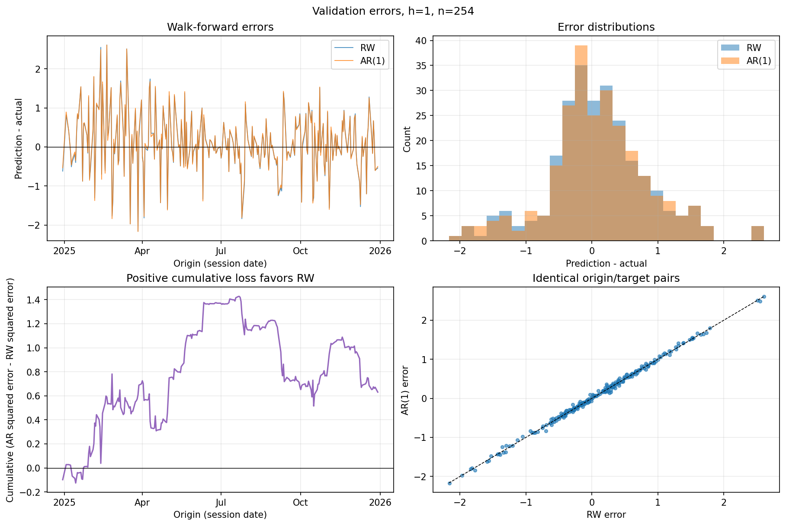

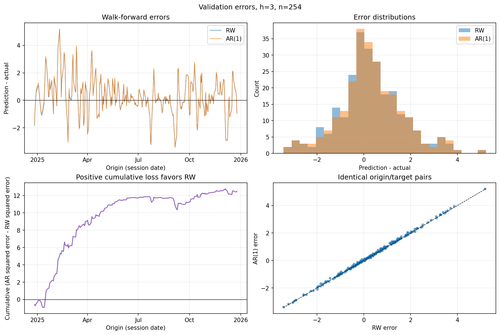

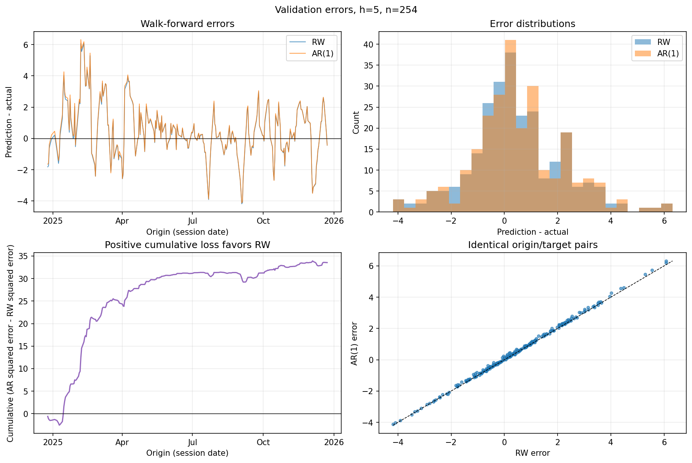

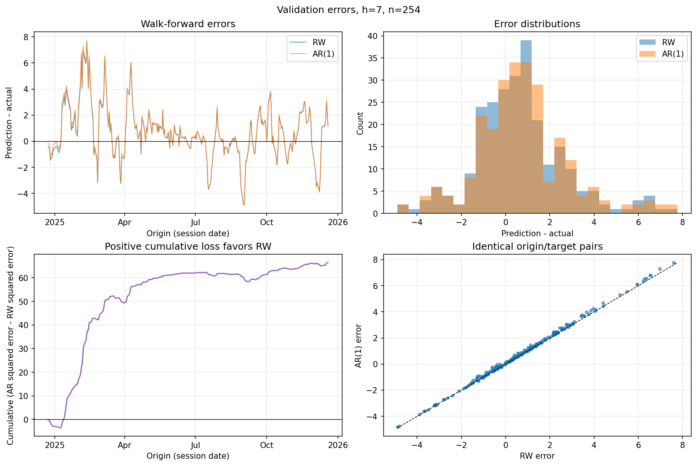

95% точечные HAC-интервалы исключают ноль на горизонтах: [3, 4, 5, 6, 7].
После Holm-коррекции p<0.05 для семи горизонтов: [].
Вывод ограничен 254 перекрывающимися парами на h, одним validation-годом и выбранным заранее HAC-лагом.
Невыявление различия не доказывает эквивалентность моделей; интервал отражает неопределённость среднего d.

## Разбиение по исторической волатильности

Train-границы sigma20: 0.00706708 и 0.00965457 (доли, не проценты).
Эти границы не оценивались на validation и не используются для переключения моделей.

Пороги считаются доступными с 2024-12-30, последней использованной train-свечи.
Origins до этой даты помечены calibration_unavailable: полные train-терцили тогда ещё недоступны.
Такие строки не участвуют в сравнении трёх групп, но сохраняются в CSV и общих benchmark-метриках.
Для h=1/3/5/7 исключено по этой причине соответственно 0/2/4/6 пар; это граница доступности,
а не отбор по качеству. sigma20 на каждом origin в любом случае вычислена только по прошлым данным.

| horizon | regime | n | rmse_rw | rmse_ar | rmse_ratio | small_sample | excluded |
| --- | --- | --- | --- | --- | --- | --- | --- |
| 1 | low | 69 | 0.707953 | 0.702981 | 0.992977 | False | False |
| 1 | medium | 97 | 0.659505 | 0.657725 | 0.9973 | False | False |
| 1 | high | 88 | 0.921831 | 0.930066 | 1.00893 | False | False |
| 3 | low | 69 | 1.45285 | 1.46896 | 1.01109 | False | False |
| 3 | medium | 95 | 1.22224 | 1.23604 | 1.01129 | False | False |
| 3 | high | 88 | 1.54451 | 1.56916 | 1.01596 | False | False |
| 3 | calibration_unavailable | 2 | — | — | — | True | True |
| 5 | low | 69 | 1.84447 | 1.8834 | 1.02111 | False | False |
| 5 | medium | 93 | 1.67107 | 1.70948 | 1.02298 | False | False |
| 5 | high | 88 | 1.88599 | 1.92468 | 1.02051 | False | False |
| 5 | calibration_unavailable | 4 | — | — | — | True | True |
| 7 | low | 69 | 2.24728 | 2.30766 | 1.02687 | False | False |
| 7 | medium | 91 | 2.1142 | 2.18477 | 1.03338 | False | False |
| 7 | high | 88 | 2.15932 | 2.21757 | 1.02698 | False | False |
| 7 | calibration_unavailable | 6 | — | — | — | True | True |

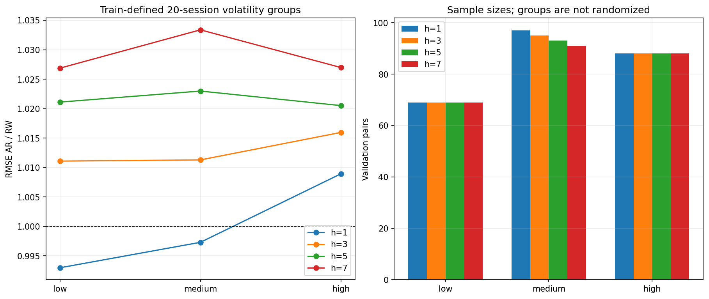

Различия ratio между группами — описательная проверка гипотезы зависимости относительного качества от
исторической волатильности. Группы не рандомизированы, наблюдения зависимы и могут совпадать с отдельными
периодами года; малые n ограничивают интерпретацию. Формальный тест взаимодействия не проводился.

На h=1 ratio ниже единицы в низкой/средней группе и выше единицы в высокой. На h=3,5,7 ratio выше
единицы во всех трёх группах. Строго монотонного ухудшения с ростом волатильности нет. Это даёт
ограниченную описательную поддержку гипотезе неоднородности h=1, но не подтверждает устойчивое
преимущество AR в отдельных режимах. В основных low/medium/high группах n>=30; строки
unavailable отражают исключённые пары, а не дополнительные режимы. Наблюдения зависимы.

## Рекурсивное разложение прогноза

На каждом сохранённом origin: a0=DeltaC_t, b0=0; ak=phi*ak−1, bk=c+phi*bk−1.
Суммы ak и bk дают соответственно вклад последней разности и константы в прогноз уровня.
C_t + sum(ak+bk) проверено против сохранённого AR-прогноза; новая AR-модель не оценивалась.

| horizon | n | mean_constant | mean_autoregressive | std_constant | std_autoregressive | mean_abs_constant | mean_abs_autoregressive | constant_dominant_share | mean_constant_loss_allocation | mean_autoregressive_loss_allocation |
| --- | --- | --- | --- | --- | --- | --- | --- | --- | --- | --- |
| 1 | 254 | 0.0128391 | -0.00540903 | 0.00991047 | 0.0425701 | 0.0128391 | 0.0312336 | 0.251969 | 0.00523999 | -0.00275802 |
| 2 | 254 | 0.0266514 | -0.00579391 | 0.0206076 | 0.044885 | 0.0266514 | 0.0328693 | 0.496063 | 0.0215007 | -0.00238091 |
| 3 | 254 | 0.0407945 | -0.00561662 | 0.0315758 | 0.0450974 | 0.0407945 | 0.0330632 | 0.61811 | 0.0486209 | 0.000550579 |
| 4 | 254 | 0.0552115 | -0.00561621 | 0.0427434 | 0.0451037 | 0.0552115 | 0.033067 | 0.724409 | 0.0855755 | 0.00293194 |
| 5 | 254 | 0.069919 | -0.00577037 | 0.0541914 | 0.0451186 | 0.069919 | 0.0331452 | 0.799213 | 0.133689 | -0.00162813 |
| 6 | 254 | 0.0849373 | -0.00587107 | 0.0659167 | 0.0451735 | 0.0849373 | 0.0332459 | 0.854331 | 0.194305 | -0.00708307 |
| 7 | 254 | 0.100278 | -0.00587552 | 0.077972 | 0.0451806 | 0.100278 | 0.0332503 | 0.877953 | 0.269348 | -0.00781822 |

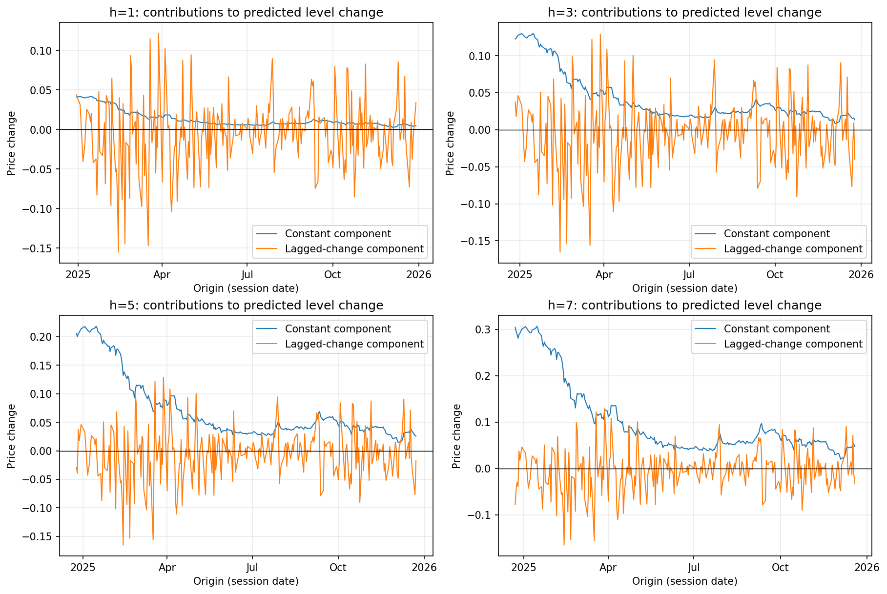

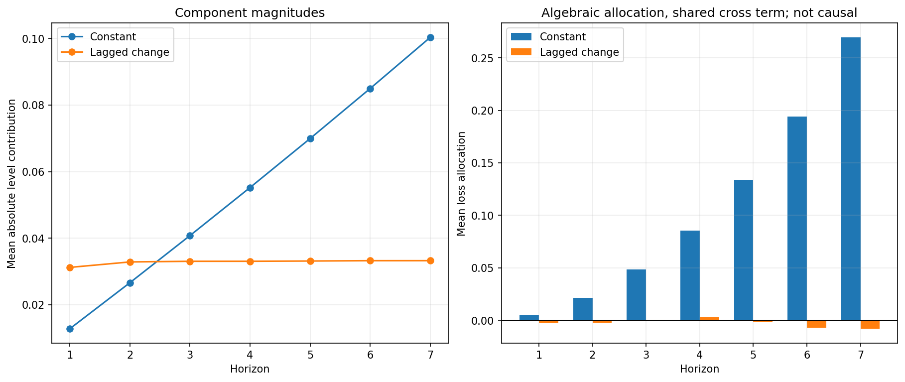

Для константы A и AR-вклада B разница потерь раскладывается на
(2*e_RW*A+A²+A*B) + (2*e_RW*B+B²+A*B). Это симметричное распределение перекрёстного члена,
не причинная оценка и не backtest вариантов без константы. Оно показывает механизм текущего прогноза.

На h=7 средний вклад константы в уровень равен 0.100278, AR-части — -0.00587552; константа больше по модулю на 87.8% пар.
Bias RW=0.656457, AR=0.750859: дополнительный положительный сдвиг равен 0.0944023, что совпадает с суммой средних компонентов.
Алгебраическое распределение среднего d: константа 0.269348, AR-часть -0.00781822; сумма 0.26153.
Таким образом, гипотеза о вкладе положительного дрейфа в ухудшение поддерживается разложением именно
сохранённого прогноза. Это не доказывает, что удаление константы улучшит OOS-качество: такой модельный
эксперимент здесь не проводился. При малом phi влияние последней разности быстро затухает,
а вклад константы накапливается по h, что согласуется с ростом положительного смещения AR.

## Выводы и следующие шаги

Подтверждено: календарная интеграция воспроизводит benchmarks; AR имеет больший validation RMSE на всех h.
Поддержаны в рамках диагностики: малые выборочные lag-1 корреляции изменений, кластеризация
абсолютных доходностей, неравномерное во времени ухудшение и положительный вклад константы в разницу потерь.
Не подтверждены: гипотеза о смене знака phi (он положителен на всех сохранённых origins),
устойчивое превосходство текущей AR над RW, монотонная связь её относительного качества с волатильностью
и семейно-значимое различие потерь при 5% после Holm-коррекции семи горизонтов.
Коэффициенты, серийная зависимость, эпизодичность ошибок, волатильностные группы и вклады константы
количественно описаны в таблицах выше. Численные изменения знака и групповое преимущество сами по себе
не устанавливают рыночные режимы, причинность или устойчивое прогнозное преимущество.
Проверка наличия полезной для условного среднего информации требует отдельного заранее описанного
исследования и честной вневыборочной проверки. Текущие модели не изменены по результатам диагностики.
Следующие шаги: завершить независимый аудит календаря/времени доступности; сформулировать до нового
эксперимента гипотезы о стабильности среднего и дисперсии; при необходимости проверять модели дисперсии
и взаимодействие с волатильностью отдельным протоколом. Сохранить final test закрытым до фиксации решений.

## Воспроизводимость

Запуск из корня: `python -m benchmarks.diagnostics_run` после установки requirements-diagnostics.txt.
Настройки зафиксированы в configs/ar1_diagnostics.yaml; копия настроек, train-пороги, версии Python/библиотек,
Git SHA, состояние рабочей папки и SHA256 входов/кода записаны в diagnostics_manifest.json.
Исходные benchmark-артефакты проверяются по хешам до/после; actuals читаются только для validation.
При запуске до коммита SHA указывает базовый коммит, а хеши — использованный незакоммиченный код.
После разрешённого коммита можно повторить диагностику для записи нового SHA. Commit/push/merge не выполнялись.
