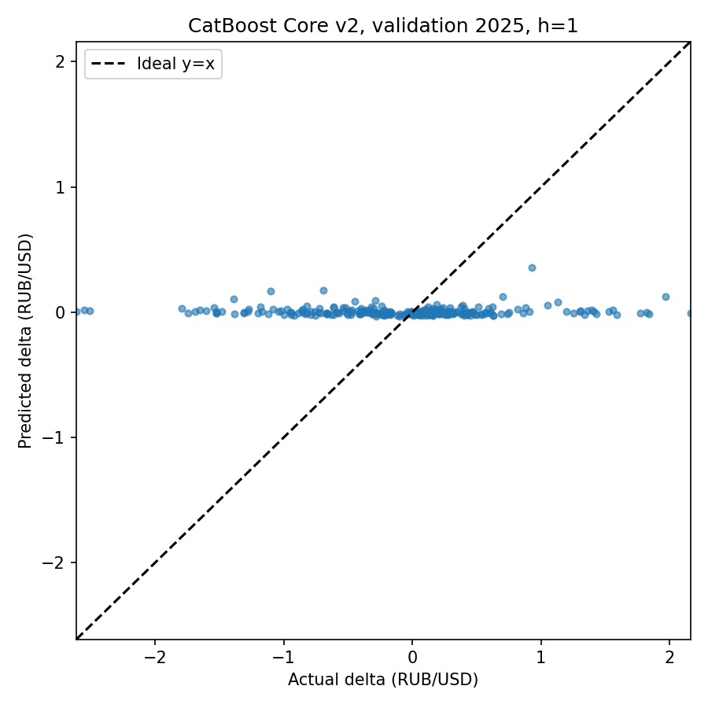
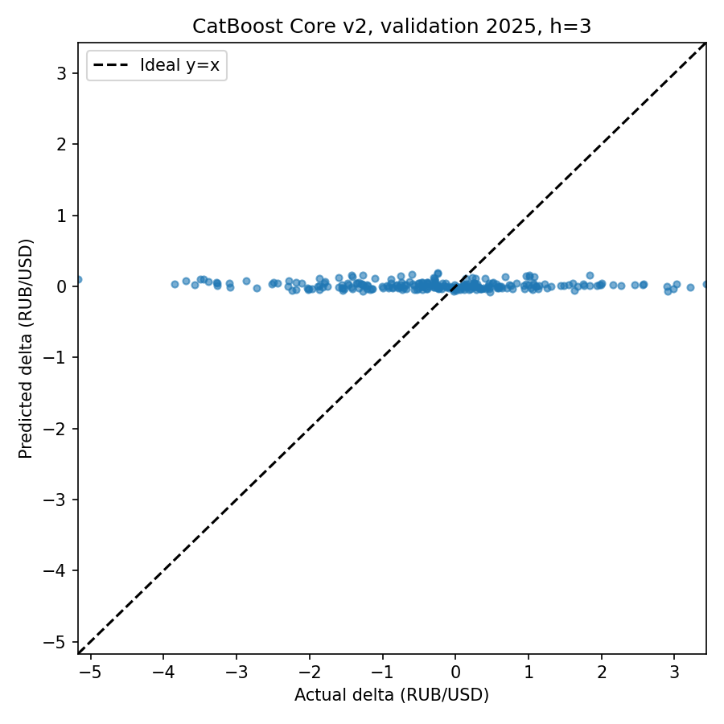
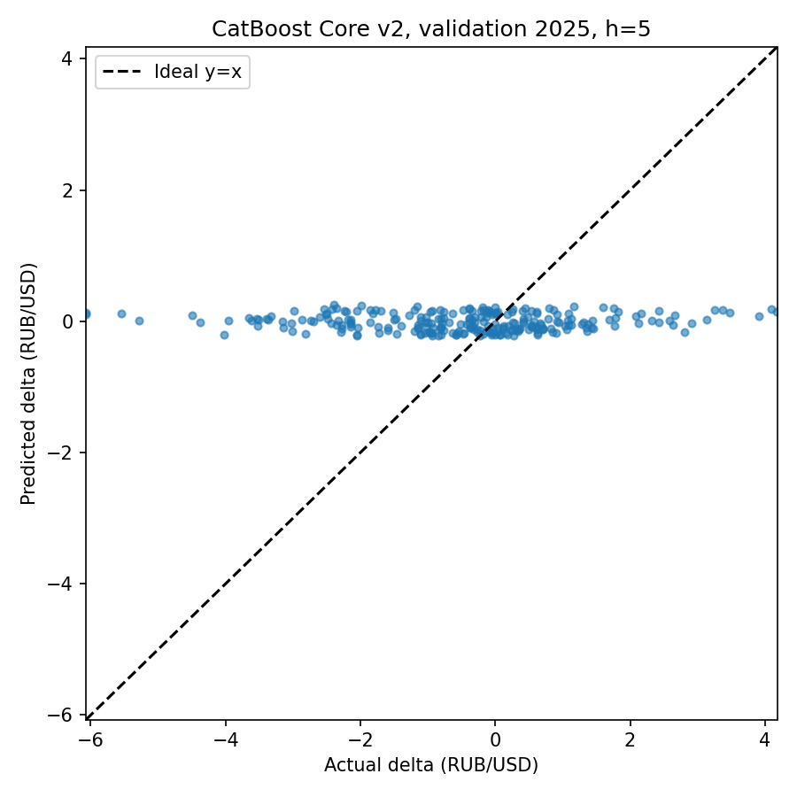
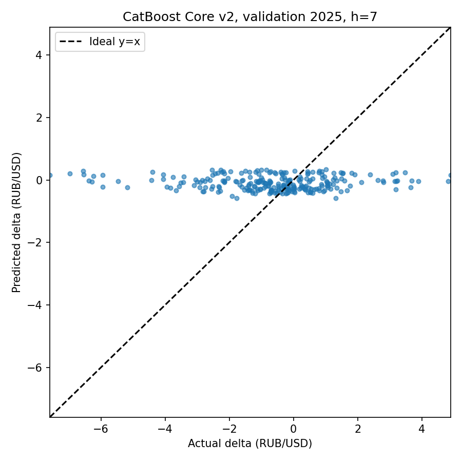

# Диагностика ошибок CatBoost Core v2: validation 2025

CatBoost остаётся близок к Random Walk: RMSE хуже RW на h=1,2,3,5 и немного лучше на h=4,6,7. Малые прогнозные поправки почти не воспроизводят амплитуду фактического движения. Преимущество меняется между кварталами и режимами волатильности. Это описательная диагностика сохранённых прогнозов, без повторного обучения, подбора признаков или оценки на 2026 году.

## Данные и контроль сопоставления

Использованы `results/catboost_core_v2/scored_common_predictions.csv`, `metrics.csv`, baseline `USDRUBF_baseline_2026-11-18.csv`, `configs/benchmark_config.yaml` и указанный в нём `usdrubf_trading_days.csv`. Фактическая схема прогнозов содержит одну модель `CatBoost_Core_v2` и колонку `RW`; baseline содержит `date,price,volume,price_type,source`, где `price_type=CANDLE_CLOSE`. Типы всех входных колонок сохранены в manifest. Скрипт также поддерживает RW отдельными строками с точным соединением по ключу.

Все семь горизонтов имеют по 254 уникальные тройки `(origin_date,target_date,horizon)`, всего 1778 наблюдений. Targets: 2025-01-03…2025-12-30; origins: 2024-12-23…2025-12-29. Декабрьские origins нужны для первых targets 2025 года. Разность позиций target и origin в торговом календаре строго равна h. Пропусков требуемых дат и цен нет. Actual совпадает с target CLOSE, RW — с origin CLOSE, прогноз — с `RW+prediction_target`. RMSE, MAE, bias и n обеих моделей совпали с контрольным `metrics.csv` для каждого h, с `rtol=1e-10, atol=1e-8`. При нарушении любого контроля скрипт завершается до записи результатов.

Ошибки определены как `prediction−actual`; `actual_delta=actual−RW`, `predicted_delta=prediction_target`. Все соединения цен и волатильности — по точным датам. Файл baseline содержит 2026 год, но эти строки исключены до расчётов цен, доходностей и волатильности. Полный файл хешируется для контроля происхождения.

## Общие ошибки и направление

Ценовые метрики — в RUB/USD. Полные MAE и bias обеих моделей: [horizon_metrics.csv](../results/catboost_error_diagnostics/horizon_metrics.csv).

| h | RMSE CatBoost | RMSE RW | RMSE/RW | bias CatBoost | Ошибка CatBoost больше RW, % | Точность направления, % | Точность без нулевых actual, % |
|---|---:|---:|---:|---:|---:|---:|---:|
| 1 | 0.773605 | 0.772440 | 1.001508 | 0.100161 | 50.39 | 49.61 | 50.20 |
| 2 | 1.141679 | 1.135664 | 1.005297 | 0.178777 | 53.94 | 46.85 | 47.22 |
| 3 | 1.414397 | 1.404904 | 1.006757 | 0.299348 | 53.94 | 47.24 | 47.62 |
| 4 | 1.614577 | 1.617355 | 0.998283 | 0.377026 | 53.54 | 47.24 | 47.24 |
| 5 | 1.791839 | 1.790585 | 1.000701 | 0.453181 | 55.51 | 47.24 | 47.81 |
| 6 | 1.958003 | 1.965425 | 0.996224 | 0.500179 | 48.03 | 53.54 | 53.75 |
| 7 | 2.145415 | 2.147724 | 0.998925 | 0.567508 | 45.28 | 57.48 | 57.71 |

На h=7 точность 57.48% не означает сильный направленный сигнал: фактических падений 162/254 (63.78%), и постоянный прогноз падения дал бы большую точность на этой выборке. Это ретроспективный ориентир дисбаланса классов, не настроенная модель. CatBoost прогнозирует падение 176 раз. На h=1…5 при фактических падениях RMSE CatBoost выше RW; на h=7 при фактическом росте отношение RMSE составляет 1.022263. При падении bias положительный, при росте отрицательный, что согласуется с недостаточной амплитудой поправок.

Ноль классифицирован заранее как **точное `delta == 0`** для actual и prediction. Фактических нулей по h: 3,2,2,0,3,1,1; предсказанных нулей нет. Нулевые actual включены в общую точность как отдельный класс и исключены только из дополнительной `accuracy_nonzero`. У RW при нулевом actual RMSE=0, поэтому отношение RMSE в этих группах не определено и записано пустым значением, а не бесконечностью. Все 3×3 комбинации confusion matrix, включая нулевые счётчики, сохранены для каждого h.

Детали: [direction_accuracy.csv](../results/catboost_error_diagnostics/direction_accuracy.csv), [direction_metrics.csv](../results/catboost_error_diagnostics/direction_metrics.csv), [direction_confusion.csv](../results/catboost_error_diagnostics/direction_confusion.csv).

## Кварталы target_date

В каждом квартале одинаковое n для всех h: Q1=61, Q2=62, Q3=66, Q4=65. Ни один h не выигрывает у RW во всех кварталах. В Q1 CatBoost хуже на всех h; во втором квартале лучше на всех h. Особенно заметна смена результата h=7: Q1 +1.42% к RMSE RW, Q2 −5.81%, Q3 +1.38%, Q4 −0.74%.

| h | Q1 RMSE/RW | Q2 RMSE/RW | Q3 RMSE/RW | Q4 RMSE/RW |
|---|---:|---:|---:|---:|
| 1 | 1.000982 | 0.999560 | 1.010035 | 0.999119 |
| 2 | 1.013086 | 0.988398 | 1.007560 | 1.000790 |
| 3 | 1.015978 | 0.997700 | 0.998658 | 1.001628 |
| 4 | 1.004273 | 0.983349 | 0.993385 | 1.000681 |
| 5 | 1.009834 | 0.977183 | 0.993782 | 1.003034 |
| 6 | 1.006001 | 0.955749 | 0.996441 | 1.003812 |
| 7 | 1.014205 | 0.941873 | 1.013801 | 0.992568 |

Все RMSE, MAE, bias и n обеих моделей: [quarterly_metrics.csv](../results/catboost_error_diagnostics/quarterly_metrics.csv).

## Волатильность на origin

Волатильность — выборочное стандартное отклонение (`ddof=1`) последних 20 дневных лог-доходностей, без годового масштабирования. Окно включает доходность завершившейся сессии origin t и требует 21 CLOSE. Это соответствует сохранённому условному EOD-прогнозу. Цены после t не используются.

Границы train из benchmark: 2022-04-26…2024-12-31. Для порогов доступны 663 полных окна с датами 2022-05-30…2024-12-30. Терцили train, линейная интерполяция: q1=0.007067084191331379, q2=0.009654573169652854. Low: vol≤q1; medium: q1<vol≤q2; high: vol>q2. Пороги не переоцениваются на validation. Границы, параметры и пороги сохранены в manifest.

В medium-режиме RMSE CatBoost выше RW на всех h (отношения 1.005254…1.018109). В high-режиме CatBoost лучше на h=1,2,4,5,6,7 и хуже на h=3; на h=7 отношение 0.973435, n=94. В low-режиме результат смешанный, на h=7 отношение 1.007463, n=69. Следовательно, ухудшение нельзя приписать исключительно высокой волатильности. Это сравнение по наблюдаемому состоянию на origin, а не причинное объяснение последующего движения.

Полные показатели и размеры групп: [volatility_metrics.csv](../results/catboost_error_diagnostics/volatility_metrics.csv).

## Амплитуда

| h | Среднее actual | Среднее prediction | std actual | std prediction | std prediction / std actual | Корреляция |
|---|---:|---:|---:|---:|---:|---:|
| 1 | −0.095000 | 0.005161 | 0.768089 | 0.036176 | 0.047099 | 0.009209 |
| 3 | −0.283346 | 0.016002 | 1.378751 | 0.051366 | 0.037256 | −0.104990 |
| 5 | −0.465748 | −0.012567 | 1.732365 | 0.127488 | 0.073592 | 0.000334 |
| 7 | −0.656457 | −0.088949 | 2.048978 | 0.219028 | 0.106896 | −0.057239 |

Поправки близки к нулю и имеют слабую либо отрицательную корреляцию с actual_delta. На h=7 фактический 5–95% диапазон равен [−4.179, 2.791], прогнозный — [−0.402, 0.267]. Малый разброс прогнозных изменений описывает поведение модели, но сам по себе не доказывает причину: это может быть связано как со слабым условным сигналом, так и с ограничениями обученной модели. По сохранённым прогнозам эти объяснения не разделить.

Все средние, std (`ddof=1`), квантили 0/5/25/50/75/95/100%, корреляции: [amplitude_summary.csv](../results/catboost_error_diagnostics/amplitude_summary.csv). Scatter: X=actual_delta, Y=predicted_delta, одинаковые пределы осей, пунктир `y=x`:






## Крупнейшие ошибки

Десять крупнейших абсолютных ошибок дают 29.04%, 27.78%, 29.30% и 36.15% общей SSE CatBoost на h=1,3,5,7 соответственно. Выбросы сохранены во всех основных метриках. Ниже — крупнейшая ошибка каждого выбранного h; все 40 строк со всеми ценами, изменениями, ошибками и индивидуальной долей SSE находятся в [top_errors.csv](../results/catboost_error_diagnostics/top_errors.csv).

| h | origin | target | Ошибка CatBoost | Ошибка RW |
|---|---|---|---:|---:|
| 1 | 2025-02-19 | 2025-02-20 | +2.616276 | +2.610000 |
| 3 | 2025-02-10 | 2025-02-13 | +5.269264 | +5.170000 |
| 5 | 2025-02-06 | 2025-02-13 | +6.199644 | +6.070000 |
| 7 | 2025-02-11 | 2025-02-20 | +7.743461 | +7.590000 |

Крупнейшие ошибки обеих моделей близки и приходятся на падение цены в феврале. Малые поправки CatBoost его не компенсируют. Концентрация SSE и перекрывающиеся многодневные горизонты означают, что отдельные эпизоды заметно влияют на годовые сравнения; строки нельзя считать независимыми событиями.

## Воспроизведение и ограничения

Из корня репозитория:

```powershell
python scripts/analyze_catboost_errors.py
python -m unittest discover -s tests -p "test_catboost_error_diagnostics.py" -v
python -m unittest discover -s tests -p "test_*.py" -q
git diff --check
```

Скрипт записывает только `results/catboost_error_diagnostics/`. Отчёт добавлен отдельно; повторный запуск анализа его не перезаписывает. [Manifest](../results/catboost_error_diagnostics/manifest.json) содержит Git SHA исходной версии, версии Python/библиотек, SHA256 пяти входных файлов, фактическую схему, параметры, границы выборок, пороги и список артефактов. [diagnostic_pairs.csv](../results/catboost_error_diagnostics/diagnostic_pairs.csv) позволяет проверить агрегаты вплоть до отдельных наблюдений. Два независимых расчёта и записи всех диагностических CSV сравниваются побайтно в тесте воспроизводимости.

Новые тесты: 13 прошли, 0 пропущено, 0 неуспешных. Полный набор: 158 тестов, 143 прошли, 15 пропущено, 0 неуспешных; время 85.723 с. `git diff --check` прошёл. Проверки запускались установленным `C:\Users\EmpathicChild\anaconda3\python.exe` (Python 3.13.5), поскольку системный alias `python.exe` недоступен внутри песочницы. Диагностика не обучает модели; обязательный общий набор включает существующие тесты моделей на синтетических данных.

Validation 2025 уже использовалась в предыдущих исследованиях; квартальные, режимные и направленные разрезы остаются exploratory. Не проводились новые проверки значимости и коррекция множественности для этих разрезов. Доля правильных направлений не оценивает торговую доходность, комиссии или исполнимость. Календарь — существующая provisional-реконструкция, не независимо проверенный архив MOEX. Сохраняются допущения conditional EOD / pseudo-PIT / ASSUMED_AVAILABLE исходных прогнозов. Выводы описывают ошибки и возможные объяснения, не устанавливают причинность и не доказывают преимущество на независимых данных. 2026 не оценивался; исходные результаты, данные и конфигурации не изменены.
