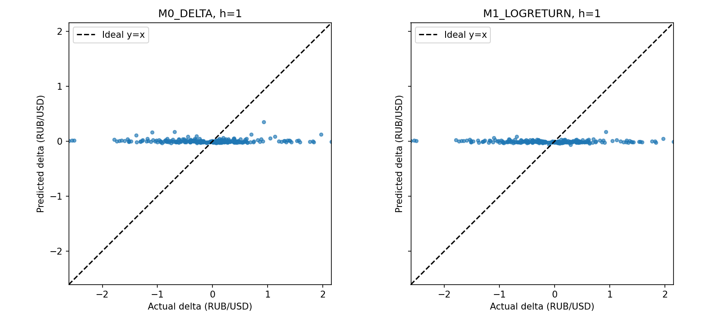
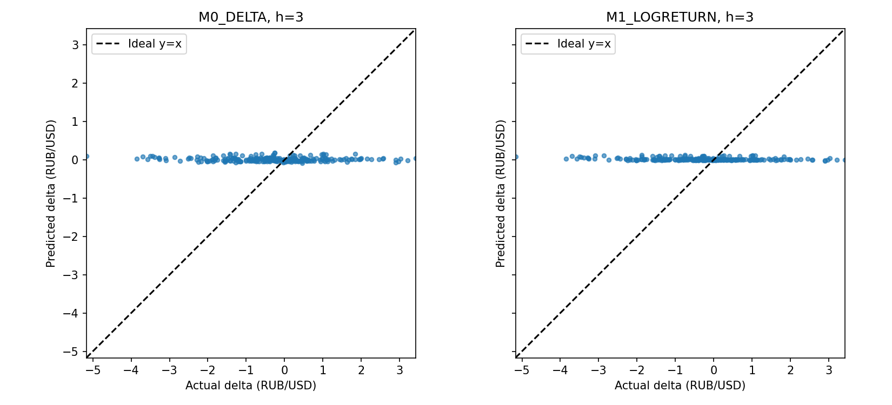
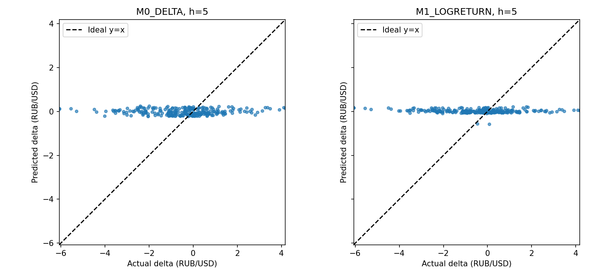
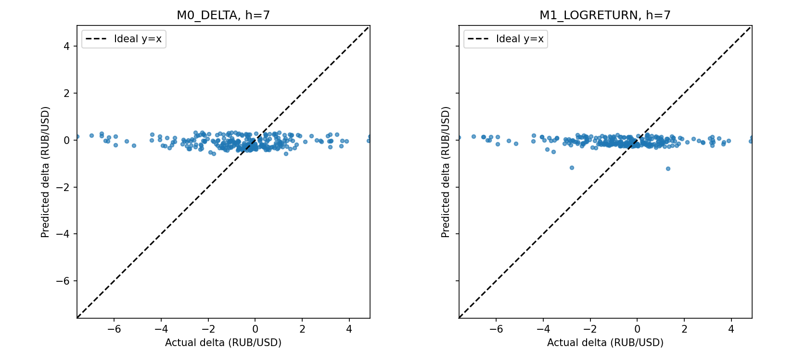

# H13 — CatBoost Delta vs Log-return

Сравнивается только target при неизменных 10 признаках Core v2, frozen v2 dataset, provisional trading calendar, origins и обучающих индексах. Validation 2025 многократно использовалась: все выводы exploratory, независимое преимущество не подтверждается. 2026 не используется для обучения, настройки и оценки.

M0_DELTA: `C[t+h]-C[t]`, восстановление `C[t]+prediction_target`. M1_LOGRETURN: `log(C[t+h]/C[t])`, восстановление `C[t]*exp(prediction_target)`. Jensen correction не применяется. Target M1 минимизирует RMSE лог-доходности при обучении; оценка обеих моделей проводится по восстановленной цене.

## Контроль и протокол

Все 1778 прогнозов M0 (254 на h) совпали с оригинальным CatBoost при atol=1e-8, rtol=1e-10. Максимальное отличие цены: 0. Все оригинальные окна, n и 10 train-only медиан воспроизведены точно. До завершения контроля всех h обучение M1 не начиналось.

Expanding/prequential refit на каждом origin; только метки с target_date≤origin_date. Train начинается с исходной первой сессии: прогрев на 19 сессий и шестёрка H11 не применяются. Индексы M0/M1 пересчитываются независимо и сравниваются целиком; сохраняются SHA256 массивов int64 little-endian, границы и n. Медианы обеих моделей сравниваются точно. Никаких eval_set, early stopping или нового подбора параметров.

Фиксировано: iterations=100, learning_rate=0.03, bootstrap_type=No, random_seed=240112, thread_count=1, loss_function=RMSE. Depth и l2_leaf_reg взяты из оригинальных h*/selection.json для каждого h и одинаковы между M0/M1. Все параметры и порядок 10 признаков приведены в manifest.

Правило невалидных значений зафиксировано до расчёта: при любой неположительной или нечисловой CLOSE, нечисловом доступном target или восстановленном прогнозе весь эксперимент останавливается. Для восстановленной log-return цены также требуется строгое значение >0 (включая контроль underflow). Нет clipping, fallback или удаления прогнозов по факту ошибки. Терминальные h недоступных меток не входят в обучение по календарной зрелости.

## OOS качество восстановленной цены

| h | n | RMSE_M0 | RMSE_M1 | RMSE_RW | M1_over_M0 | M1_over_RW |
| --- | --- | --- | --- | --- | --- | --- |
| 1 | 254 | 0.773605 | 0.773685 | 0.772440 | 1.000104 | 1.001612 |
| 2 | 254 | 1.141679 | 1.136840 | 1.135664 | 0.995761 | 1.001036 |
| 3 | 254 | 1.414397 | 1.418245 | 1.404904 | 1.002720 | 1.009496 |
| 4 | 254 | 1.614577 | 1.627020 | 1.617355 | 1.007706 | 1.005976 |
| 5 | 254 | 1.791839 | 1.809171 | 1.790585 | 1.009673 | 1.010380 |
| 6 | 254 | 1.958003 | 1.974922 | 1.965425 | 1.008641 | 1.004832 |
| 7 | 254 | 2.145415 | 2.151561 | 2.147724 | 1.002865 | 1.001787 |

M1 имеет меньший RMSE, чем M0, на h=[2]; меньший RMSE, чем RW, на h=[]. Это описательное сравнение; MAE, bias=prediction−actual, RMSE/RW и n всех трёх моделей находятся в [metrics.csv](../results/h13_catboost_logreturn/metrics.csv).

Изменение RMSE M1 относительно M0 по h=1…7, %: +0.0104, -0.4239, +0.2720, +0.7706, +0.9673, +0.8641, +0.2865.

## Основной контраст HAC/Holm

`d=(M1−actual)^2−(M0−actual)^2`; отрицательное среднее благоприятно для M1. Newey–West, Bartlett, lag=max(20,h−1), поправка n/(n−1), двусторонняя нормальная аппроксимация. Holm применяется совместно к ровно семи заранее объявленным сравнениям h=1…7. Приведённые 95% CI не скорректированы за множественность. Сравнение с RW описательное и не добавляет тестов в это семейство.

| horizon | mean_squared_loss_difference | hac_se | ci_low | ci_high | p_two_sided | holm_p |
| --- | --- | --- | --- | --- | --- | --- |
| 1 | 0.000124 | 0.001528 | -0.002870 | 0.003118 | 0.935119 | 0.935119 |
| 2 | -0.011026 | 0.009201 | -0.029061 | 0.007008 | 0.230797 | 0.692391 |
| 3 | 0.010898 | 0.007348 | -0.003504 | 0.025300 | 0.138036 | 0.552143 |
| 4 | 0.040333 | 0.021465 | -0.001737 | 0.082403 | 0.060240 | 0.361437 |
| 5 | 0.062412 | 0.028466 | 0.006621 | 0.118204 | 0.028340 | 0.198379 |
| 6 | 0.066542 | 0.037708 | -0.007364 | 0.140448 | 0.077620 | 0.388101 |
| 7 | 0.026412 | 0.030525 | -0.033416 | 0.086240 | 0.386899 | 0.773798 |

После Holm при alpha=0.05 значимые горизонты: []. Отсутствие значимости не доказывает эквивалентность.

Без поправки p<0.05 на h=[5]; эти результаты нельзя считать значимыми после Holm, если скорректированное p≥0.05.

## Амплитуда, bias и направление

| model_id | horizon | predicted_delta_mean | predicted_delta_std | actual_delta_mean | actual_delta_std | bias | std_ratio | correlation | direction_accuracy |
| --- | --- | --- | --- | --- | --- | --- | --- | --- | --- |
| M0_DELTA | 1 | 0.005161 | 0.036176 | -0.095000 | 0.768089 | 0.100161 | 0.047099 | 0.009209 | 0.496063 |
| M1_LOGRETURN | 1 | -0.005737 | 0.021293 | -0.095000 | 0.768089 | 0.089263 | 0.027722 | -0.077680 | 0.448819 |
| M0_DELTA | 2 | -0.009884 | 0.057605 | -0.188661 | 1.122095 | 0.178777 | 0.051337 | -0.108928 | 0.468504 |
| M1_LOGRETURN | 2 | -0.017882 | 0.034763 | -0.188661 | 1.122095 | 0.170780 | 0.030980 | -0.101628 | 0.500000 |
| M0_DELTA | 3 | 0.016002 | 0.051366 | -0.283346 | 1.378751 | 0.299348 | 0.037256 | -0.104990 | 0.472441 |
| M1_LOGRETURN | 3 | 0.020835 | 0.033950 | -0.283346 | 1.378751 | 0.304182 | 0.024623 | -0.260317 | 0.425197 |
| M0_DELTA | 4 | 0.002656 | 0.110011 | -0.374370 | 1.576537 | 0.377026 | 0.069780 | 0.066650 | 0.472441 |
| M1_LOGRETURN | 4 | 0.008517 | 0.057605 | -0.374370 | 1.576537 | 0.382887 | 0.036539 | -0.119397 | 0.433071 |
| M0_DELTA | 5 | -0.012567 | 0.127488 | -0.465748 | 1.732365 | 0.453181 | 0.073592 | 0.000334 | 0.472441 |
| M1_LOGRETURN | 5 | 0.018166 | 0.085998 | -0.465748 | 1.732365 | 0.483914 | 0.049642 | -0.142488 | 0.429134 |
| M0_DELTA | 6 | -0.059821 | 0.194267 | -0.560000 | 1.887677 | 0.500179 | 0.102913 | 0.004503 | 0.535433 |
| M1_LOGRETURN | 6 | -0.026619 | 0.136753 | -0.560000 | 1.887677 | 0.533381 | 0.072445 | -0.093141 | 0.523622 |
| M0_DELTA | 7 | -0.088949 | 0.219028 | -0.656457 | 2.048978 | 0.567508 | 0.106896 | -0.057239 | 0.574803 |
| M1_LOGRETURN | 7 | -0.069079 | 0.171702 | -0.656457 | 2.048978 | 0.587378 | 0.083799 | -0.104240 | 0.559055 |

Std прогнозируемого изменения M1 ниже M0 на h=[1, 2, 3, 4, 5, 6, 7]. Для M1 отношение std(predicted_delta)/std(actual_delta) составляет 2.46–8.38%, для M0 — 3.73–10.69%. Смена target не устраняет ранее обнаруженную малую амплитуду. Корреляция M1 отрицательна на h=[1, 2, 3, 4, 5, 6, 7]. Большая дисперсия прогноза не используется как критерий выбора.

Std рассчитывается с ddof=1. Направление восстановленной цены определяется по `sign(prediction−C[t])`, фактическое — по `sign(actual−C[t])`; ноль — точное равенство нулю, без подбора порога. Нулевые фактические и прогнозные изменения, верные нули и точность без нулевых actual приведены отдельно в behavior.csv. Полные 3×3 матрицы для каждой модели и h — в direction_confusion.csv. RW всегда прогнозирует ноль; его корреляция не определена. Основной критерий — OOS RMSE цены: увеличение дисперсии прогноза само по себе не означает улучшения.









## Артефакты и воспроизведение

```powershell
python scripts/run_h13_catboost_logreturn.py
python -m unittest discover -s tests -p "test_h13_catboost_logreturn.py" -v
python -m unittest discover -s tests -p "test_*.py" -q
git diff --check
python scripts/run_h13_catboost_logreturn.py --report-only
```

Полный запуск требует пустого output-каталога, чтобы не смешивать эксперименты. Скрипт никогда не перезаписывает исторические результаты. Автоматически сформированный отчёт сохраняется в results и reports; `--report-only` пересобирает его из сохранённых таблиц и validation.json без обучения. Прогнозы до scoring: predictions_oos.csv. Оценённые прогнозы: scored_predictions.csv, парное сопоставление: paired_predictions.csv (`prediction`=M0, `prediction_reference`=M1, `d`=SSE M1−SSE M0 для строки). Контроль оригинала: m0_reproduction.csv; окна обеих моделей: training_windows.csv. В manifest зафиксированы SHA исходного Git, версии библиотек, параметры, SHA256 входов и защищённых данных, отсутствие 2026 в числовых данных и фактические диапазоны дат. Для новых артефактов закреплён LF в .gitattributes, чтобы SHA256 сохранялись при Windows checkout.

Протокол conditional EOD / pseudo-PIT / ASSUMED_AVAILABLE и provisional-календарь унаследованы от Core v2. Многодневные ошибки перекрываются, HAC учитывает автокорреляцию с фиксированным лагом, но один повторно используемый validation-год ограничивает выводы. Статистическое различие здесь не доказывает независимую воспроизводимость или торговую доходность.

## Проверки

H13 new tests: выполнено 16, прошли 16, пропущено 0, failures=0, errors=0.

Full unittest suite: выполнено 174, прошли 159, пропущено 15, failures=0, errors=0.

git diff --check: passed. Воспроизведены все 1778 M0 и 21 M1 (первый/средний/последний origin каждого h); эти 21 M1 совпали побитно как float64, включая prediction_target. Дополнительно проверена повторяемость обеих моделей и неизменность прогноза после изменения данных позже origin на синтетической панели.
